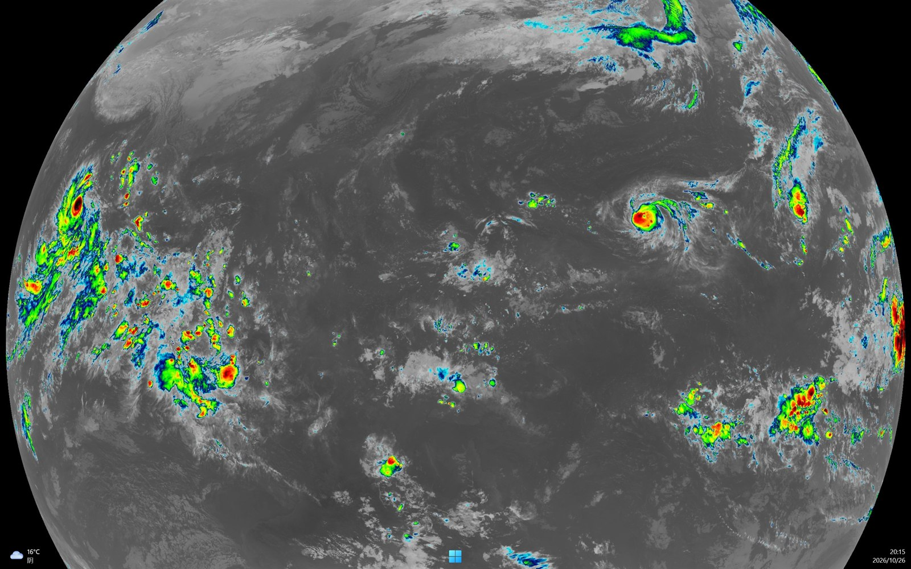

# SatWall

**Live satellite imagery as your desktop wallpaper, on a schedule.**

A small PowerShell project that pulls geostationary satellite imagery for your
region, stitches the tiles, and sets the result as the wallpaper of *one*
monitor — leaving your main screen alone. It switches between true color in
daylight and enhanced infrared after dark, automatically.



*Enhanced infrared after dark — 2752×2752, refreshed every 30 minutes.*

## Features

- **Per-monitor wallpaper** — uses `IDesktopWallpaper`, so only the chosen
  screen changes. Your main desktop stays as it was.
- **Day/night aware** — true color (4400×4400) while the sun is up, enhanced
  infrared (2752×2752) after sunset. Sunrise/sunset computed locally from solar
  declination, no API needed.
- **Tray icon** — the icon *is* a thumbnail of the latest image. Right-click to
  refresh, force a mode, pause, or open the full-size picture.
- **Zero dependencies** — Windows PowerShell 5.1 and .NET's built-in
  `System.Drawing`. No Python, no WSL, no compiler, no admin rights.
- **Relocatable** — every script resolves its own folder via `$PSScriptRoot`;
  drop the directory anywhere.

## Requirements

- Windows 10 or 11
- Windows PowerShell 5.1 (ships with Windows)

## Install

```powershell
# in the project folder
powershell -ExecutionPolicy Bypass -File .\setup.ps1
```

The installer will:

1. list your monitors and ask which one should show the imagery,
2. write `config.json`,
3. register a scheduled task `SatWallpaper` that refreshes on an interval,
4. drop a tray shortcut into your Startup folder,
5. fetch the first image immediately.

Non-interactive:

```powershell
.\setup.ps1 -MonitorIndex 1 -Latitude 31.2 -IntervalMinutes 30
```

## Configuration

`config.json` (generated by the installer, safe to edit by hand):

```json
{
  "root": "C:\\Users\\you\\Pictures\\SatWall",
  "monitorIndex": 1,
  "latitude": 32.0,
  "intervalMinutes": 30,
  "trueColorGrid": 8,
  "infraredZoom": 2
}
```

| key | meaning |
|---|---|
| `monitorIndex` | monitor index as printed by `setup.ps1`; `-1` = first non-primary |
| `latitude` | only affects *when* the IR cut-over happens (Beijing 39.9, Shanghai 31.2, Guangzhou 23.1) |
| `intervalMinutes` | refresh interval |
| `trueColorGrid` | tile grid for true color; `8` → 4400×4400 |
| `infraredZoom` | IR zoom level; `2` → 2752×2752, `3` → 5504×5504 (slower) |

## Data sources

| Use | Source | Notes |
|---|---|---|
| True color | [`himawari.asia`](https://himawari.asia) (NICT, Japan) | Himawari-9, 10-min cadence, ~20 min latency |
| Enhanced IR | [CIRA SLIDER](https://slider.cira.colostate.edu) (Colorado State) | `band_13` 10.4 µm window IR, cold cloud tops tinted |

Both are freely accessible without an API key. Tiles are fetched directly and
stitched locally with `System.Drawing`.

## Known limitations

- **True color is pure black on the night hemisphere.** That is physics, not a
  bug — which is exactly why the IR switch exists.
- The tray icon requires an interactive login (Startup folder shortcut).
- Sunrise/sunset are estimated from latitude alone; expect ±15 minutes. Use the
  tray menu to force a mode if it guesses wrong on a given day.
- Outages of the upstream tile services are not handled beyond a retry loop; the
  tray tooltip simply stops advancing.

## Uninstall

```powershell
Unregister-ScheduledTask -TaskName SatWallpaper -Confirm:$false
Remove-Item "$([Environment]::GetFolderPath('Startup'))\SatelliteWallpaper.lnk"
```

Then kill the tray `powershell.exe` and delete the folder.

## License

MIT — see [LICENSE](LICENSE).

---

[中文说明](README.zh-CN.md)
